# Iltatähti P-18

Kumimoottorilla lentävä sisälennokki P-18-luokkaan (AMA event 227, Limited). Kone on
suunniteltu kokonaan koodina: yhdestä build123d-mallista syntyvät 3D-malli, laserleikkurin
polttotiedostot 2 mm ja 4 mm balsalle, 3D-tulostettava moottoripukki sekä A0-kokoinen
rakennuspiirustus, jonka pääkuvat ovat mittakaavassa 1:1.

Suunnittelija: J. Juslin, DI

<p align="center">
  
</p>

Yllä oleva SVG pyörii itsestään ja tekee täyden kierroksen vuorotellen kunkin akselin
ympäri, 8 sekuntia kunkin:

| Akseli | Liike | Väri |
|---|---|---|
| Z, pystyakseli | suunta (yaw) | sininen |
| X, pituusakseli | kallistus (roll) | punainen |
| Y, poikittaisakseli | nyökkäys (pitch) | vihreä |

Pyörimisakseli näkyy kuvassa katkoviivana. GitHub ei salli README:n SVG-kuvissa hiirellä
ohjattavaa vuorovaikutusta, joten pyöriteltävä malli on erillisenä STL-tiedostona (ks. alla).

### Pyöriteltävä ja zoomattava 3D-malli

Avaa [step/iltatahti_p18.stl](step/iltatahti_p18.stl) GitHubissa. Tiedosto aukeaa
3D-katselimeen, jossa mallia voi pyörittää hiirellä ja zoomata rullalla. CAD-ohjelmiin
sopii [step/iltatahti_p18.step](step/iltatahti_p18.step), ja Blenderiin sekä
selainkatseluun [step/iltatahti_p18.glb](step/iltatahti_p18.glb).

## Rakennuspiirustus

<p align="center">
  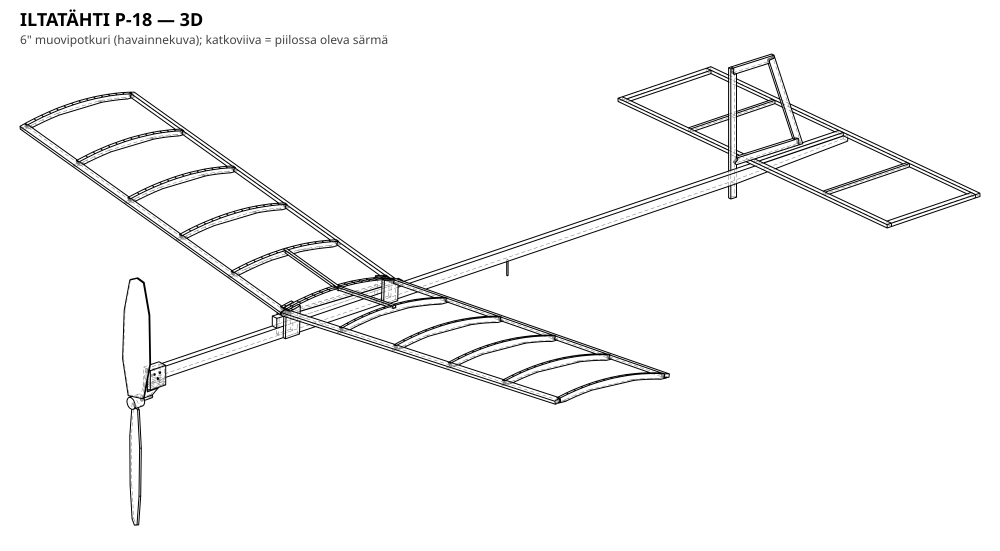
</p>

Sama 3D-kuva kuin rakennuspiirustuksen yläreunassa: koko kone ja 6" muovipotkuri edestä
vasemmalta ylhäältä. Piilossa olevat särmät on piirretty harmaalla katkoviivalla.

[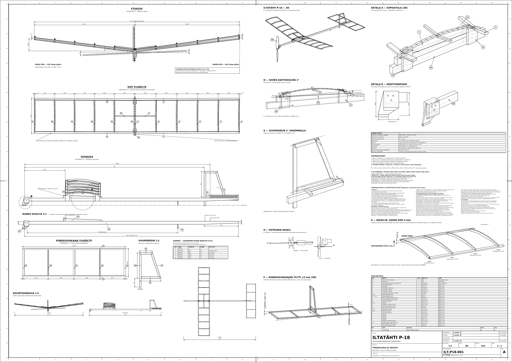](piirustus/ILT-P18-001_A.pdf)

Tulosta [piirustus/ILT-P18-001_A.pdf](piirustus/ILT-P18-001_A.pdf) A0-koossa 100 %
mittakaavalla. Piirustuksessa on 100 mm:n tarkistusmitta, jolla voi varmistaa, että
1:1-kuvat tulostuivat oikean kokoisina. Vektoriversio on
[piirustus/ILT-P18-001_A.svg](piirustus/ILT-P18-001_A.svg).

## Tekniset tiedot

<!-- BEGIN:tekniset -->
| | |
|---|---|
| Siipi | 480 mm rimoja pitkin (vasen 245, oikea 235), projektio 477,2 mm, jänne 80 mm |
| V-kulma | 7,02° kummallakin puoliskolla (DXF-riman 9 tyviviiste) |
| Asetuskulma / wash-in | siipi +2° kiilalla, vasemman siiven johtoreuna kärjessä 4 mm ylempänä |
| Korkeusvakaaja | 240 × 66,2 mm, tasainen, 5 kaarta, kallistus ±5 mm |
| Sivuperäsin | 50/30 × 60 mm, kääntyvä, 2° vasemmalle |
| Runkotikku | 7 × 4 × 497 mm balsaa, takapää kapenee 4 mm:iin; hiilikuitulatat 0,1 × 1 mm päällä ja alla |
| Koukkuväli | 350 mm |
| Vetoviiva | 0° ylös/alas, 2° vasemmalle; akseli 9,8 mm tikun alapinnan alapuolella |
| Kokonaispituus | 507 mm |
| Potkuri | 6" kaupallinen muovipotkuri, laakeri 2 lasihelmeä + ≥ 3 mylar-prikkaa, teflonöljy |
| Materiaalit | balsa 60–70 kg/m³ (2 mm ja 4 mm levyt), moottoripukki PETG, kalvo mylar 2 µm + 3M77 |
<!-- END:tekniset -->

## P-18 Limited -säännöt lyhyesti

AMA event 227 ja P-18 Online Indoor Postal Contest -kilpailun Limited-luokka:

1. Kumimoottorilla lentävä yksitaso. Kate on silkkipaperia tai ohutta HDPE-muovipussia;
   postikilpailun ohjeen mukaan hedelmäpussia, joka liimataan 3M 77 -suihkeliimalla.
2. Siiven jänne on enintään 4,5" (114,3 mm) ja projisoitu kärkiväli enintään 18" (457,2 mm).
3. Korkeusvakaajan kärkiväli on enintään 9" (228,6 mm) ja jänne enintään 3,5" (88,9 mm).
4. Kokonaispituus potkuri mukaan lukien on enintään 18" (457,2 mm).
5. Potkuri on muuttamaton kaupallinen muovipotkuri, jonka nimellishalkaisija on enintään 6".
   Potkuria ei saa hioa, kaapia eikä muuttaa sen nousua. Toiseen lapaan saa lisätä
   tasapainotuspainon. Oman akselin ja laakeroinnin saa tehdä, ja potkurin oman
   muoviripustimen saa jättää pois.
6. Koukkuväli on enintään 10" (254 mm).
7. Kone painaa ilman kumimoottoria **vähintään 7,5 g**.
8. **Limited: moottori on yksi kumilenkki. Kuminauha on ennen solmimista enintään 40"
   (1016 mm) pitkä, eli solmittu lenkki on noin 19 3/4" (502 mm).** Standard-luokassa kumia
   ei rajoiteta.
9. Kilpailuun lähetettävän piirustuksen on täytettävä jänne- ja kärkivälirajat.

### Mallin sääntötarkistus

Mallista mitatut arvot, jotka `p18_iltatahti.py` tarkistaa jokaisella päivityksellä:

<!-- BEGIN:saannot -->
| Sääntö | Mitta | Malli mm | Raja mm | |
|---:|---|---:|---:|---|
| 3 | siiven kärkiväli (projektio) | 477,2 | 457,2 | ❌ ylittyy |
| 3 | siiven jänne (projektio) | 82,6 | 114,3 | ✅ |
| 4 | korkeusvakaajan kärkiväli | 239,9 | 228,6 | ❌ ylittyy |
| 4 | korkeusvakaajan jänne | 66,2 | 88,9 | ✅ |
| 5 | kokonaispituus potkuri mukaan lukien | 507,0 | 457,2 | ❌ ylittyy |
| 7 | koukkuväli | 350,0 | 254,0 | ❌ ylittyy |

> **Huom.** Malli ylittää P-18-rajan: siiven kärkiväli (projektio), korkeusvakaajan kärkiväli, kokonaispituus potkuri mukaan lukien, koukkuväli. Kilpailukoneessa nämä mitat pitää pienentää rajojen sisään.
<!-- END:saannot -->

> **Kate:** sääntö 1 mainitsee katteeksi vain silkkipaperin ja HDPE-pussin. Ennen kilpailua
> kannattaa varmistaa järjestäjältä, käykö 2 µm:n mylar-kalvo.

## Painobudjetti, tavoite 7,5 g ilman kumia

Budjetti on laskettu osa osalta laserosien tilavuuksista. Jos jokainen osa pysyy omassa
budjetissaan, koko kone painaa enintään 7,5 g. P-18-säännöissä 7,5 g on vähimmäispaino,
joten budjetin alle jäävä osuus lisätään painona, esimerkiksi toiseen potkurin lapaan
tai painopisteen korjaukseen. Punnitse balsalevyt ennen leikkausta: tiheys on
massa / (pituus × leveys × paksuus).

<!-- BEGIN:paino -->
Balsaosien budjetti on laskettu 70 kg/m³:n balsalle (raskain sallittu levy): laserosan pinta-ala × levyn paksuus mallista. Arvio-rivit ovat kokemusperäisiä ylärajoja.

#### Vasen siipi

| Osa | Nimi | Mitat mm | Budjetti g |
|---:|---|---|---:|
| 1 | vasen siipi: etureunarima | 245,0×4,0×2 | 0,136 |
| 2 | vasen siipi: jättöreunarima | 245,0×4,0×2 | 0,136 |
| 3 | vasen siipi: tyvikaari (täysi, keskiriman lovi) | 78,1×7,1×2 | 0,058 |
| 4 | vasen siipi: siipikaari 1 (keskiriman lovi) | 78,7×7,1×2 | 0,036 |
| 5 | vasen siipi: siipikaari 2 | 78,4×7,1×2 | 0,037 |
| 6 | vasen siipi: siipikaari 3 | 78,0×7,1×2 | 0,037 |
| 7 | vasen siipi: siipikaari 4 | 77,6×7,1×2 | 0,037 |
| 8 | vasen siipi: siipikaari 5 | 77,3×7,1×2 | 0,037 |
| 9 | vasen siipi: V-kulman keskirima | 50,3×1,5×2 | 0,011 |
| 10 | vasen siipi: satulan etutuki | 10,0×17,6×2 | 0,022 |
| 11 | vasen siipi: satulan takatuki | 10,0×15,2×2 | 0,019 |
|  | kalvo mylar 2 µm, vasen puolisko | 196 cm² +10 % | 0,060 |
|  | liimat (kaaret, rimat, tuet) ja 3M77 | arvio | 0,060 |
| | **Vasen siipi yhteensä** | | **0,685** |

#### Oikea siipi

| Osa | Nimi | Mitat mm | Budjetti g |
|---:|---|---|---:|
| 12 | oikea siipi: etureunarima | 235,0×4,0×2 | 0,131 |
| 13 | oikea siipi: jättöreunarima | 235,0×4,0×2 | 0,131 |
| 14 | oikea siipi: tyvikaari (täysi, keskiriman lovi) | 78,1×7,1×2 | 0,058 |
| 15 | oikea siipi: siipikaari 1 (keskiriman lovi) | 79,3×7,1×2 | 0,036 |
| 16 | oikea siipi: siipikaari 2 | 79,3×7,1×2 | 0,037 |
| 17 | oikea siipi: siipikaari 3 | 79,3×7,1×2 | 0,037 |
| 18 | oikea siipi: siipikaari 4 | 79,3×7,1×2 | 0,037 |
| 19 | oikea siipi: siipikaari 5 | 79,3×7,1×2 | 0,037 |
| 20 | oikea siipi: V-kulman keskirima | 48,3×1,5×2 | 0,010 |
| 21 | oikea siipi: satulan etutuki | 10,0×17,6×2 | 0,022 |
| 22 | oikea siipi: satulan takatuki | 10,0×15,2×2 | 0,019 |
|  | kalvo mylar 2 µm, oikea puolisko | 188 cm² +10 % | 0,057 |
|  | liimat (kaaret, rimat, tuet) ja 3M77 | arvio | 0,060 |
| | **Oikea siipi yhteensä** | | **0,671** |

#### Korkeusvakaaja

| Osa | Nimi | Mitat mm | Budjetti g |
|---:|---|---|---:|
| 23 | korkeusvakaaja: etureunarima | 240,0×3,1×2 | 0,104 |
| 24 | korkeusvakaaja: jättöreunarima | 240,0×3,1×2 | 0,104 |
| 25 | korkeusvakaaja: kaari, vasen kärki | 60,0×4,0×2 | 0,034 |
| 26 | korkeusvakaaja: kaari, vasen puoliväli | 60,0×2,0×2 | 0,017 |
| 27 | korkeusvakaaja: kaari, keskellä | 60,0×4,0×2 | 0,034 |
| 28 | korkeusvakaaja: kaari, oikea puoliväli | 60,0×2,0×2 | 0,017 |
| 29 | korkeusvakaaja: kaari, oikea kärki | 60,0×4,0×2 | 0,034 |
|  | kalvo mylar 2 µm | 159 cm² +10 % | 0,049 |
|  | liimat ja 3M77 | arvio | 0,030 |
| | **Korkeusvakaaja yhteensä** | | **0,421** |

#### Sivuperäsin

| Osa | Nimi | Mitat mm | Budjetti g |
|---:|---|---|---:|
| 30 | sivuperäsin: johtoreuna + sarana-akseli | 4,9×80,0×2 | 0,044 |
| 31 | sivuperäsin: alarima | 44,4×4,4×2 | 0,024 |
| 32 | sivuperäsin: ylärima | 28,6×4,1×2 | 0,015 |
| 33 | sivuperäsin: jättöreuna | 23,2×60,0×2 | 0,033 |
|  | kalvo mylar 2 µm | 24 cm² +10 % | 0,007 |
|  | liimat, S-saumat ja 3M77 | arvio | 0,015 |
|  | saranan mehupilli (pahvi, ~25 mm) + karhulanka + CA | arvio | 0,080 |
| | **Sivuperäsin yhteensä** | | **0,218** |

#### Runko

| Osa | Nimi | Mitat mm | Budjetti g |
|---:|---|---|---:|
| 34 | runkotikku | 497,0×7,0×4 | 0,941 |
| 35 | kohtauskulmakiila 2° | 89,9×6,1×4 | 0,115 |
|  | hiilikuitulatta tikun päällä | 0,1×1×497 mm, 1,6 g/cm³ | 0,080 |
|  | hiilikuitulatta tikun alla | 0,1×1×497 mm, 1,6 g/cm³ | 0,080 |
|  | CA-liima latoille | arvio | 0,030 |
|  | liimat: kiila, satulan tuet tikkuun, pukki | arvio | 0,030 |
| | **Runko yhteensä** | | **1,274** |

#### Moottoripukki ja potkuri

| Osa | Nimi | Mitat mm | Budjetti g |
|---:|---|---|---:|
| 36 | moottoripukki PETG (pukki.py) | 546 mm³ umpinainen, 1,27 g/cm³ | 0,693 |
|  | potkurin akseli, pianolanka | ⌀1,0 × 45 mm | 0,277 |
|  | 2 lasihelmeä | arvio | 0,030 |
|  | 3 mylar-prikkaa + teflonöljy | arvio | 0,010 |
| 38 | potkuri 6" (STEM, ilman ripustinta) | arvio — punnitse | 2,500 |
| | **Moottoripukki ja potkuri yhteensä** | | **3,510** |

#### Takakoukku

| Osa | Nimi | Mitat mm | Budjetti g |
|---:|---|---|---:|
| 37 | takakumikoukku, pianolanka | ⌀0,8 × 40 mm | 0,158 |
|  | karhulankasidonta + CA | arvio | 0,020 |
| | **Takakoukku yhteensä** | | **0,178** |

#### Yhteenveto

| Ryhmä | Budjetti g |
|---|---:|
| Vasen siipi | 0,685 |
| Oikea siipi | 0,671 |
| Korkeusvakaaja | 0,421 |
| Sivuperäsin | 0,218 |
| Runko | 1,274 |
| Moottoripukki ja potkuri | 3,510 |
| Takakoukku | 0,178 |
| **Yhteensä ilman kumia** | **6,958** |
| Varaus / painotus 7,5 g:aan | 0,542 |
| **Tavoite (P-18 sääntö 8)** | **7,5** |

Balsaa yhteensä enintään 2,63 g. Kumimoottori ei kuulu painoon.
<!-- END:paino -->

## Rakentamisohjeita

### Takakumikoukku

- Taivuta koukku 40 mm:n pätkästä 0,8 mm:n pianolankaa. Noin 15 mm langasta jää
  kiinnitysosaksi tikun kylkeen. Loppuosa taivutetaan suoraan alas vetoviivan korkeudelle,
  9,8 mm tikun alapinnan alapuolelle. Pään avoin koukku taivutetaan kumilenkkiä varten.
- Koukku tulee 356 mm:n päähän tikun etupäästä, jolloin koukkuväli on 350 mm. Noin
  502 mm:n Limited-lenkki on silloin 1,43-kertainen koukkuväliin nähden, joten löysää ja
  oksia on vähän. P-18-kilpailussa koukkuväli saa olla enintään 254 mm (sääntö 7). Kohta on kaiverrettu 4 mm:n laserlevyn runkotikkuihin poikittaisena
  viivana, ja tikun alareunassa oleva kolmio osoittaa, että koukku tulee alapuolelle.
- Kiinnitä koukku sitomalla se tiukasti karhulangalla tikun kylkeen. Kierrä lanka
  kiinnitysosan ympäri 8–10 kertaa ja kastele sidonta ohuella CA-liimalla.
- Pyöristä koukun sisäkaari, jotta se ei viillä kumia. Kumin suojaksi koukun päälle voi
  pujottaa lyhyen palan silikoni- tai kutisteletkua.

### Sivuperäsimen kiinnitys

- Sivuperäsimen johtoreunarima (osa 30) jatkuu 20 mm alarimaa alemmas. Tämä jatke on
  peräsimen sarana-akseli.
- Akseli kulkee noin 25 mm pitkän pahvisen mehupillin pätkän läpi. Pilli sidotaan
  pystyasentoon runkotikun oikeaan kylkeen karhulangalla, 417–422 mm tikun etupäästä
  (jättöreunan tyvi on 30 mm ennen tikun takapäätä).
- Kierrä karhulankaa pillin ja tikun ympäri pillin ylä- ja alapäässä 6–8 kertaa ja kastele
  sidonta ohuella CA-liimalla. Älä päästä liimaa pillin sisälle.
- Valitse pilli, johon 2 × 4 mm rima menee tiukasti mutta kääntyvästi. Peräsin pysyy
  kitkan varassa asennossaan ja käännetään trimmatessa: lähtöasento on 2° vasemmalle.

### Potkurin laakerointi

Potkuri laakeroidaan pukin laakeriputkeen kahdella lasihelmellä ja vähintään kolmella
mylar-prikalla. Laakeri voidellaan teflonöljyllä. Potkurin akseli on 9,8 mm tikun
alapinnan alapuolella. Sivuveto ja alaveto ovat valmiina pukin laakeriputken kulmassa, ja
niitä säädetään tiedostossa `pukki.txt`.

### Kumimoottori: leveys ja kierrokset

**2,5 mm leveä kumi, 40" nauhasta solmittu lenkki (noin 502 mm, 2 säiettä):
enimmäiskierrokset arviolta noin 1 400 (1 300–1 500), kun kumi on esivenytetty ja
kierretään venytettynä. Lähtökierrokset noin 1 200–1 300.**

Arvio perustuu kumimoottorien kokemussääntöön: enimmäiskierrokset ≈ 32 × lenkin pituus
tuumina / √(säikeiden määrä × leveys tuumina) = 32 × 19,75 / √(2 × 0,098) ≈ 1 400.
Kumierien välillä on noin ±10 % eroja, joten varmista oman kumin raja vääntömittarilla tai
uhraamalla yksi koelenkki.

**Backoff noin 8 m korkeassa hallissa: kierrä täyteen, noin 1 400 kierrokseen, ja pura
noin 150 kierrosta (≈ 10 %). Lähtö on silloin noin 1 250 kierroksella. Säädä purkua 25
kierroksen askelin niin, että kone käy korkeimmillaan noin 0,5–1 m katon alapuolella.**
Jos kone osuu kattoon, pura enemmän. Jos se jää selvästi katon alle, pura vähemmän.

**Leveyssuositus 40" (1016 mm) Limited-nauhalle:** aloita noin **2,4 mm:n (3/32")**
leveydellä ja kokeile väliltä 2,0–2,8 mm. Kun nauhan pituus on lukittu, leveys on ainoa
säätö:

- Leveämpi kumi varastoi enemmän energiaa ja antaa enemmän vääntöä, mutta kestää vähemmän
  kierroksia.
- Paras leveys on se, jonka vääntö nostaa koneen hitaasti katon korkeudelle ja pitää sen
  ilmassa lennon loppuun asti.
- Matalaan saliin sopii kapeampi kumi, korkeaan halliin leveämpi.

**Kierrosten lisääminen:**

1. **Valmistelu.** Leikkaa 1016 mm:n nauha, solmi lenkiksi ja varmista solmu. Esivenytä
   uusi lenkki varovasti 3–4-kertaiseksi muutaman kerran. Tarkista, ettei kumissa ole
   viiltoja tai lommoja.
2. **Punonta.** Kierrä lenkkiin 50–100 kierrosta, taita se kaksinkertaiseksi ja anna sen
   kiertyä itsensä ympäri. Punottu kumi pysyy lennon lopussa kasassa eikä heilu kohti
   runkoa.
3. **Kierrin.** Käytä välityksellistä kierrintä, esimerkiksi 10:1 tai 15:1. Kierrokset ovat
   kammen kierrokset kerrottuna välityssuhteella.
4. **Venytyskierto.** Lukitse potkuri ja pidä konetta rungosta, tai käytä apulaista tai
   telinettä. Irrota kumin takapää takakoukusta ja kiinnitä se kiertimeen. Venytä kumi
   noin 3–4-kertaiseksi ja aloita kierto. Kävele kohti konetta kierron edetessä, niin
   että kierrosten loppuessa olet koneen luona. Kiinnitä kumi takaisin takakoukkuun.
5. **Kierrosmäärä.** Ensimmäisillä lennoilla kierrä noin puolet arvioidusta
   enimmäismäärästä ja lisää noin 10 % lento kerrallaan. Jos käytössä on vääntömittari,
   kierrä haluttuun vääntöön ja pura ennen lähtöä 5–10 % kierroksista (8 m hallissa
   noin 10 %, ks. backoff yllä). Lopeta lisääminen,
   jos solmuja alkaa kertyä koukkujen lähelle tai kumi alkaa kiristyä epätasaisesti.
6. **Kirjanpito.** Kirjaa jokaisesta lennosta kumin leveys ja paino, kierrokset, vääntö,
   lentoaika ja suurin korkeus. Niiden avulla löydät parhaan leveyden ja kierrosmäärän.
7. **Turvallisuus.** Käytä kierrettäessä suojalaseja, sillä kumi voi katketa. Säilytä kumia
   viileässä ja pimeässä.

## Ohjelmisto

Koko kone päivittyy yhdellä komennolla. Pythonin virtuaaliympäristössä `.venv` tarvitaan
build123d, shapely, ezdxf, svgelements, cairosvg ja numpy, ja PNG-kuvaa varten `pdftoppm`
(poppler-utils).

```bash
.venv/bin/python sync_all.py            # päivitä kaikki, mihin on tullut muutoksia
.venv/bin/python sync_all.py --watch    # päivitä aina, kun jokin tiedosto tallennetaan
.venv/bin/python sync_all.py --force    # rakenna kaikki uudelleen
.venv/bin/python readme_assets.py       # päivitä README:n kuvat, taulukot ja STL
.venv/bin/python pukki.py --check       # vertaa parametrista pukkia alkuperäiseen pukki-v6:een
```

VS Codessa sama toimii tehtävällä *Iltatähti: synkronoi* (Ctrl+Shift+B).

`sync_all.py` tunnistaa, mikä on muuttunut, ja päivittää vain tarvittavat tulosteet:

| Muutos | Päivittyy |
|---|---|
| `p18_iltatahti.py`, `pukki.py`, `pukki.txt`, `dxf_parts.py`, DXF, `overrides/*.json` | 3D-malli, laser-SVG:t, rakennuspiirustus |
| `to_laser.py` | laser-SVG:t |
| `drawing.py` | rakennuspiirustus |
| laser-SVG:tä muokattu Inkscapessa | muokatut osat luetaan takaisin malliin (`overrides/`), sitten kaikki |

Moottoripukkia säädetään tiedostossa `pukki.txt`: sivuveto, alaveto, laakerireiän
halkaisija, runkotikun korkeus ja taskun vara. Runkotikun korkeus muuttaa myös koko
3D-mallin.

## Tiedostot

| Tiedosto | Sisältö |
|---|---|
| `p18_iltatahti.py` | 3D-malli: siipi, korkeusvakaaja, sivuperäsin, runkotikku, kiila, sääntötarkistus |
| `pukki.py`, `pukki.txt` | parametrinen 3D-tulostettava moottoripukki ja sen säädöt |
| `to_laser.py` | laserleikkurin SVG:t: osien asettelu levylle, 1 mm sillat, kaiverretut osanumerot |
| `drawing.py` | A0-rakennuspiirustus (SVG + PDF) |
| `sync_all.py` | muutosten tunnistus ja päivitys |
| `readme_assets.py` | README:n kuvat, tekniset tiedot, sääntötarkistus ja painobudjetti |
| `dxf_parts.py`, `hyttynen4-indoor-ff-supply-5cm-49cm.dxf` | alkuperäiset DXF-osat, joista kaarien profiili ja rimat on otettu |
| `laser/osat2mm-*.svg`, `laser/osat4mm-*.svg` | polttotiedostot 50 × 500 mm balsalevyille; vanhat versiot ovat kansiossa `laser/arkisto/` |
| `step/` | koko kone (STEP, GLB, STL) ja moottoripukki tulostusta varten (`pukki.stl`, `pukki.step`) |
| `piirustus/` | rakennuspiirustus ILT-P18-001 A (PDF, SVG) |
| `osat_esitys.svg`, `iltatahti_dxf_osat.svg` | numeroitu osaesitys ja DXF:n osat |
| `pukki-v6.step` | alkuperäinen moottoripukki, joka on vertailukappale parametriselle pukille |
| `bigsmash.*`, `p-18_pursuit.*`, `p18_cruiser.*` | amerikkalaiset P-18-piirustukset taustamateriaalina |

## Vasemman siiven rakennusjigi

Vasen siipi rakennetaan jigissä, jonka osat leikataan laserilla yhdestä 6 mm:n
balsalaudasta. Jigiin tarvitaan 529 × 83 mm:n pala. Jigin tekee
[vasemman_siiven_jigi.py](vasemman_siiven_jigi.py), ja kaikki 13 osaa ovat samassa
leikkaustiedostossa [laser/jigi_vasen_siipi1.svg](laser/jigi_vasen_siipi1.svg).
Jokaiseen osaan on kaiverrettu osanumero ja teksti JIGI-VASEN-SIIPI.

- **Seinät:** johto- ja jättöreunan seinät kulkevat rimojen keskikohtien alla.
- **Wash-in:** johtoreunan seinä nousee tasaisesti tyvestä kärkeen, ja kärkikaaren
  kohdalla se on 4 mm jättöreunan seinää korkeammalla. Siipeen tulee wash-in ilman shimmejä.
- **Kaarihaarukat:** keskiseinästä nousee jokaisen siipikaaren kohdalla haarukka, joka
  pitää 2 mm:n kaaren pystyssä paikallaan ilman nuppineuloja.
- **Nuppineularistikko:** poikkikappaleet kaarien väleissä. Niiden päissä olevat matalat
  listat pitävät johto- ja jättöreunariman paikallaan.
- **Tukipalat:** pohjan tukipalat on upotettu seinien loviin.

### Jigin kokoaminen

<p align="center">
  
</p>

Uusi osa näkyy oranssina ensin ylhäällä ja sitten paikallaan. Kokoa jigi tasaisella
alustalla:

1. Tukipalat pystyyn.
2. Johtoreunan seinä, keskiseinä ja jättöreunan seinä tukipalojen päälle.
3. Tyven ja kärjen seinät ylhäältä.
4. Ristikon poikkikappaleet seinien yläloviin.

Liimaa liitokset ja tarkista, että jigi seisoo suorassa.

### Siiven rakentaminen jigillä

<p align="center">
  
</p>

Jigi on harmaa, jo paikallaan olevat siiven osat tummat ja uusi osa oranssi. Rakenna
siipi tässä järjestyksessä:

1. Jättöreunarima ja johtoreunarima seinien päälle reunalistoja vasten.
2. Siipikaaret haarukoihin kielekkeet rimojen loviin.
3. Tyvikaari tyviseinän päälle.
4. V-kulman keskirima kaarien loviin.

Liimaa ohuella syanoakrylaatilla, ja kiinnitä tarvittaessa nuppineuloja ristikkoon rimojen
viereen. Vahaa tai teippaa haarukat ja ristikko ennen liimausta, jotta siipi ei tartu jigiin.

Animaatiot ja jigi päivittyvät mallin mukana, kun ajat
`.venv/bin/python vasemman_siiven_jigi.py` ja `.venv/bin/python readme_assets.py`.

## Lennokin tarkastusjigi

Valmis kone lukitaan tarkastusjigiin runkotikusta. Jigillä tarkistetaan:

1. potkurin sivuveto;
2. korkeusvakaajan tiltti ja se, että vakaaja on suora ja keskellä;
3. siiven wash-in ja se, että siivet ovat muuten suorat;
4. siiven asetuskulma;
5. se, että vasen siipi on 1 cm oikeaa pidempi (245 mm / 235 mm rimoja pitkin).

Jigin tekee [lennokin_tarkastusjigi.py](lennokin_tarkastusjigi.py), ja jigin 9 osaa
leikataan samasta 6 mm:n balsalaudasta kuin siipijigi. Osat mahtuvat yhdelle
1886 × 83 mm:n palalle. Leikkaustiedosto on
[laser/jigi_tarkastus1.svg](laser/jigi_tarkastus1.svg), ja jokaiseen osaan on
kaiverrettu osanumero 1–9 ja teksti JIGI-TARKASTUS. Leikkaustiedostossa on vain jigin
osat, koska lennokin omat osat on jo leikattu tiedostoista `laser/osat2mm-*.svg` ja
`laser/osat4mm-*.svg`. OCP CAD Viewerissä jigi ja tarkistettava kone näkyvät nimillä
`lennokin_tarkastusjigi.py: …`.

**Mittausperiaate:** jokainen vertailureuna on suora ja tasan 5 mm tarkastettavasta
rakenteesta. Työnnä 5 mm:n mittapala tai 5 mm:n poranvarsi rakoon ja liu'uta sitä koko
matkan. Jos rako on joka kohdassa 5 mm, rakenne on suora ja oikeassa kulmassa.

### Tarkastaminen

Paina runkotikku rungon kannattimien 4 ja 5 loviin. Lovet ovat tiukat.

| Tarkistus | Oikein, kun | 1 mm virhe raossa tarkoittaa |
|---|---|---|
| Sivuveto 2° vasemmalle | potkuri vaaka-asennossa: rako potkurin vertailulevyyn (osa 3) on 5 mm molempien lapojen kärjissä | ≈ 0,38° (kärkien raoissa 1 mm ero) |
| Siivet suorat ja V-kulma | rako 5 mm johtoreunan ja jättöreunan vertailuun (osat 6 ja 7) koko kärkivälillä | kiero tai taipunut rima |
| Vasen siipi 1 cm pidempi | siiven rimojen kärjet ovat vertailujen 6 ja 7 päiden tasalla molemmissa päissä. Vertailujen vasen pää on 243 mm ja oikea 234 mm keskiviivasta. | siipi liian lyhyt tai pitkä, tai ei keskellä |
| Wash-in (vasen siipi) | rako 5 mm vasemman johtoreunan vertailuun koko matkalla; vertailu nousee kärkeen 4 mm | wash-in liian suuri tai pieni |
| Asetuskulma | rako 5 mm sekä johtoreunassa että jättöreunassa | ≈ 0,7° (raot 81,5 mm:n päässä toisistaan) |
| Korkeusvakaaja suora, tiltti ±5 mm | rako 5 mm molempiin vakaajan vertailuihin (osat 8 ja 9) koko kärkivälillä; vertailujen vasen pää on 5 mm korkeammalla ja oikea 5 mm matalammalla kuin keskikohta | vakaaja kiero tai tiltti väärä |
| Korkeusvakaaja keskellä | vakaajan rimojen kärjet ovat vertailujen 8 ja 9 päiden tasalla (±120 mm) | vakaaja sivussa |

Potkurin vertailulevy on potkurilevyn suuntainen eli käännetty 2° sivuvedon mukaan. Jos
vasemman ja oikean lavan kärjen raot ovat yhtä suuret, sivuveto on oikein. Alavetoa (0°)
jigi ei tarkista.

**Validointi 3D-mallilla:** koko kone potkureineen on asetettu mallissa jigin
kannattimiin, ja raot on mitattu.

| Mitattu | Tulos |
|---|---|
| Raot siiven ja vakaajan vertailuihin | 4,99–5,00 mm koko matkalla |
| Potkurin lapojen kärjet (vaaka-asennossa) | vasen 4,99 mm, oikea 4,99 mm |
| Oikean siiven asetuskulma | 1,98° |
| Vasemman siiven asetuskulma | 2,44° tyvessä (y −40), 4,66° kärjessä (y −230) wash-inin vuoksi |
| Vakaajan vertailun päät | ±5,00 mm |
| Siiven rimojen kärjet ja vertailujen päät | johtoreuna −243,1 / +233,7 mm, jättöreuna −243,6 / +233,7 mm, eli vasen siipi on vaakaprojektiona 9,4–9,9 mm pidempi (rimoja pitkin 10 mm) |
| Koneen kosketus jigiin | vain runkotikku kannattimien tiukassa sovitteessa |

Vertailureunat ja potkurin vertailulevy lasketaan suoraan koneen mallista ja
[pukki.txt](pukki.txt):n sivuvedosta. Jos jokin arvo muuttuu, aja
`.venv/bin/python lennokin_tarkastusjigi.py` ja leikkaa muuttuneet osat uudelleen.

### Tarkastusjigin kokoaminen

<p align="center">
  
</p>

Animaatio toistuu. Jokainen osa näkyy ensin oranssina 30 mm paikkansa yläpuolella ja
asettuu sitten paikalleen. Osan päällä oleva numero on sama kuin osaan kaiverrettu
numero. Kokoa jigi tasaisella pöydällä animaation järjestyksessä. Vasen ja oikea
tarkoittavat lentäjän vasenta ja oikeaa, ja nokka osoittaa potkurin vertailulevyn suuntaan.

1. **Kiskot 1 (vasen) ja 2 (oikea)** pöydälle 60 mm:n päähän toisistaan, lovet ylös.
   Kiskojen etupäissä on lovi potkurin vertailulevylle.
2. **Potkurin vertailulevy 3** kiskojen etupäiden loviin niin, että keskilovi tulee
   rungon kohdalle. Levy on sivuvedon verran vinossa, ja sen vasen pää on hieman
   kauempana nokasta.
3. **Rungon kannattimet 4 (etu) ja 5 (taka)** kiskojen yläloviin niin, että runkotikun
   lovi on ylhäällä keskellä. Kannattimet eivät ulotu pöytään asti.
4. **Siiven vertailut 6 (johtoreuna) ja 7 (jättöreuna)** kiskojen loviin, keskilovi
   rungon kohdalle. Pidempi pää tulee vasemmalle, koska vasen siipi on 1 cm pidempi.
   Johtoreunan vertailussa vasen pää nousee myös jyrkemmin (wash-in).
5. **Korkeusvakaajan vertailut 8 (johtoreuna) ja 9 (jättöreuna)** kiskojen takapään
   loviin. Korkeampi pää tulee vasemmalle, koska vakaajan vasen kärki on 5 mm ylempänä.
6. Liimaa liitokset ja tarkista, että jigi seisoo pöydällä keikkumatta.
7. **Lennokki:** paina runkotikku kannattimien 4 ja 5 loviin.
8. **Potkuri:** käännä potkuri vaaka-asentoon ja mittaa rako vertailulevyyn 3 kummastakin
   lavan kärjestä.

#### Vaihe vaiheelta

Sama kokoaminen kuvina. Kussakin kuvassa vaiheen uusi osa on oranssina numeroineen, ja
jo paikallaan olevat osat ovat tummina. Numero on sama kuin osaan kaiverrettu numero.

<!-- BEGIN:tarkastus-vaiheet -->
| | |
|---|---|
| 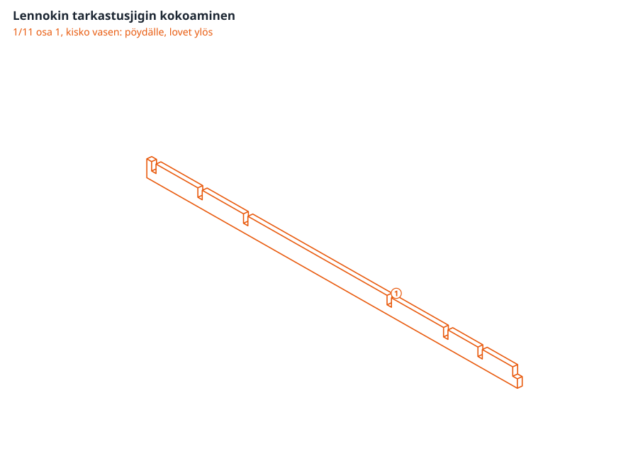<br>1/11  osa 1, kisko vasen: pöydälle, lovet ylös | 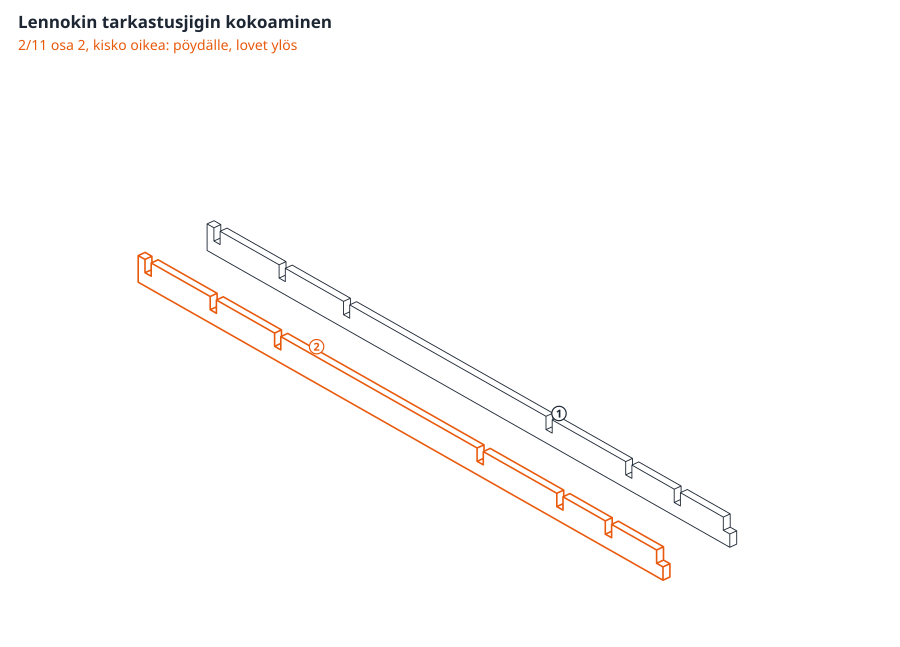<br>2/11  osa 2, kisko oikea: pöydälle, lovet ylös |
| 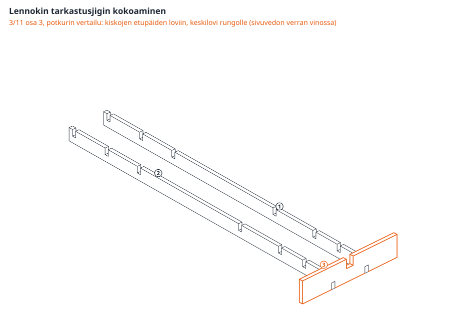<br>3/11  osa 3, potkurin vertailu: kiskojen etupäiden loviin, keskilovi rungolle (sivuvedon verran vinossa) | 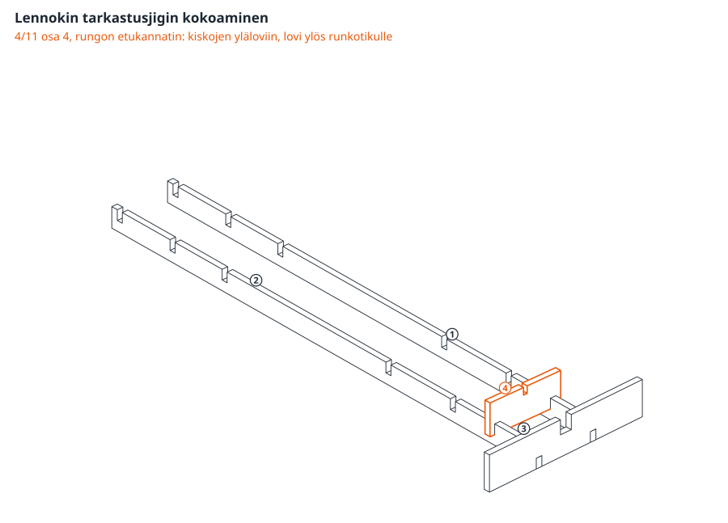<br>4/11  osa 4, rungon etukannatin: kiskojen yläloviin, lovi ylös runkotikulle |
| 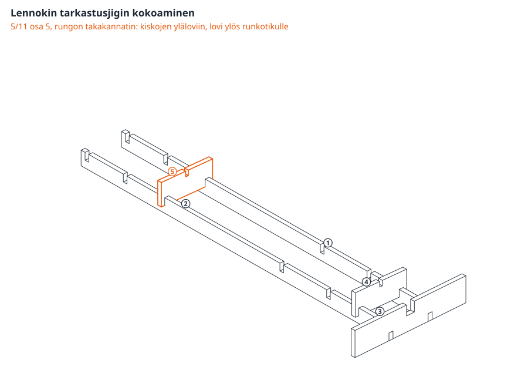<br>5/11  osa 5, rungon takakannatin: kiskojen yläloviin, lovi ylös runkotikulle | 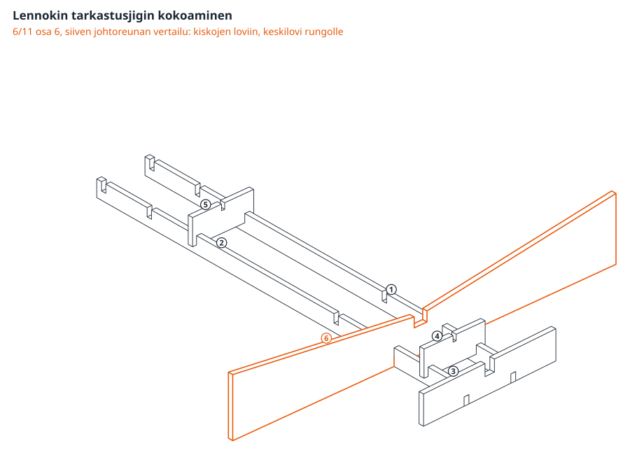<br>6/11  osa 6, siiven johtoreunan vertailu: kiskojen loviin, keskilovi rungolle |
| 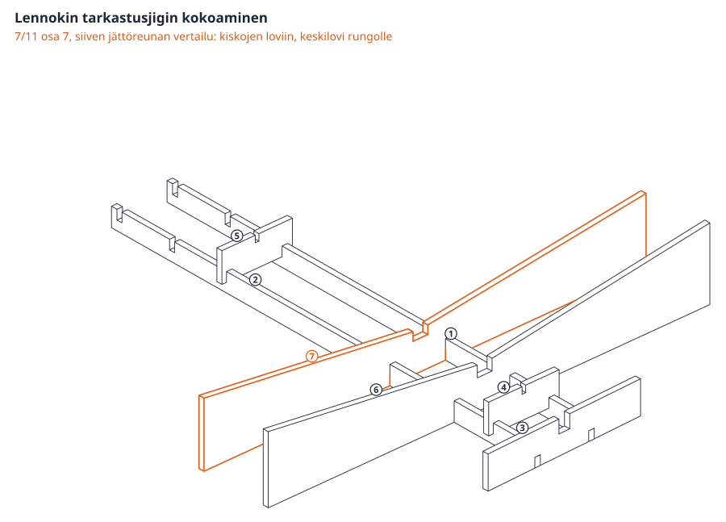<br>7/11  osa 7, siiven jättöreunan vertailu: kiskojen loviin, keskilovi rungolle | 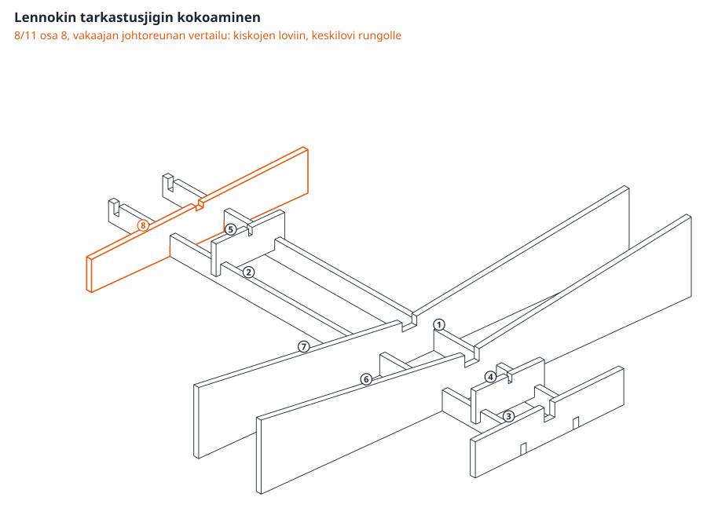<br>8/11  osa 8, vakaajan johtoreunan vertailu: kiskojen loviin, keskilovi rungolle |
| 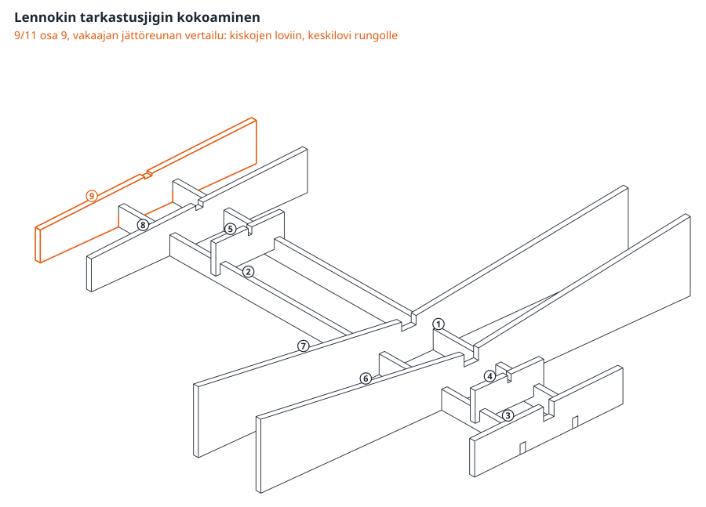<br>9/11  osa 9, vakaajan jättöreunan vertailu: kiskojen loviin, keskilovi rungolle | 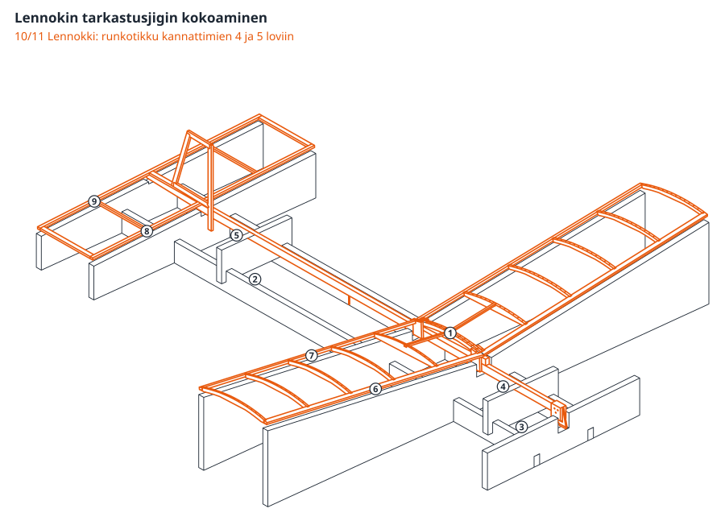<br>10/11  Lennokki: runkotikku kannattimien 4 ja 5 loviin |
| 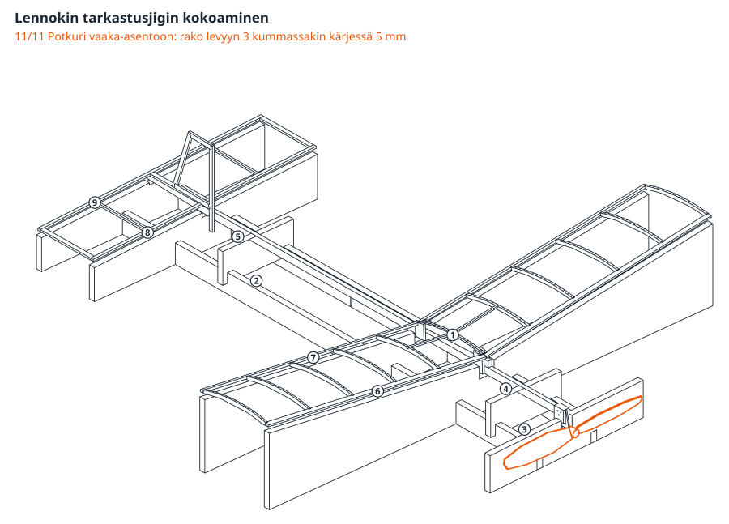<br>11/11  Potkuri vaaka-asentoon: rako levyyn 3 kummassakin kärjessä 5 mm | 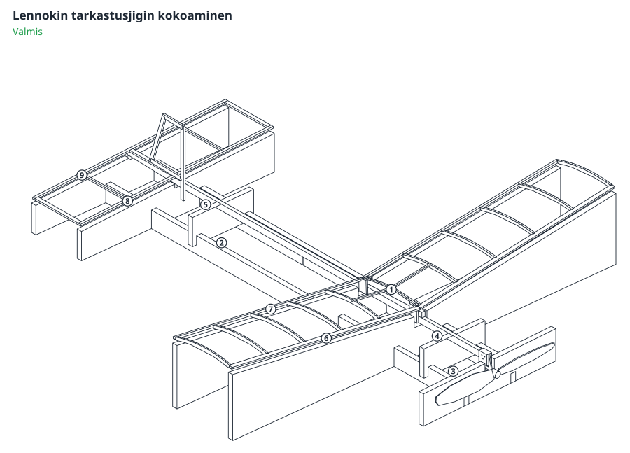<br>Valmis |
<!-- END:tarkastus-vaiheet -->

| Osa | Nimi | Paikka |
|---|---|---|
| 1, 2 | kiskot | pöydälle pituussuuntaan, lovet ylös |
| 3 | potkurin vertailulevy | kiskojen etupäiden loviin, 5 mm potkurin lapojen taakse |
| 4, 5 | rungon kannattimet | kiskojen yläloviin, 4 mm:n lovi ylös runkotikulle |
| 6, 7 | siiven johtoreunan ja jättöreunan vertailu | kiskojen loviin, keskilovi rungolle |
| 8, 9 | korkeusvakaajan johtoreunan ja jättöreunan vertailu | kiskojen loviin, keskilovi rungolle |
